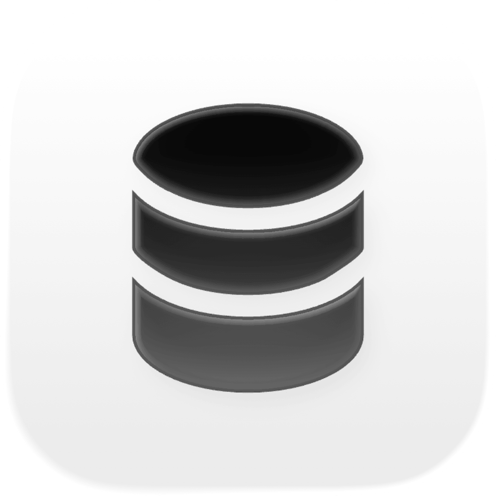

<p align="center"></p>

# TableStudio for Claude Code, Cursor, Codex and OpenCode

Your coding agent works on your databases through [TableStudio](https://tablestudio.sh), the native macOS database client, instead of reading `DATABASE_URL` from `.env` and running `psql` against whatever it points at.

- **Safe to point at production.** Every read the agent runs is read-only *in the database* (a read-only transaction with a 30-second limit), not just "looks like a SELECT". Production, and any remote database you haven't tagged as development or staging, never takes a direct write: the agent proposes the change and only you can apply it, with Touch ID. A data change on a remote database needs a dry run first and commits only if the row count still matches.
- **You see everything it does.** TableStudio's **Agent Center** lists each conversation (which agent, which repo, which chat) and every call it made: what it read, what it dry-ran, what it proposed, what TableStudio stopped. "Open Chat" takes you back to the conversation.
- **Reviews you can actually judge.** A proposed change opens with a verdict, the rows it touches, what would fail (NULLs before `SET NOT NULL`, duplicates before `UNIQUE`, orphans before a foreign key), locks and rewrites, a **diagram of the schema after the change**, and an undo plan. The agent puts a link to the review in the chat. Send it back with "Request changes" and the agent revises it in place.
- **Your schema, TableStudio's diagram.** Ask for the schema and the agent reads it in one call; ask for an ER diagram and it opens TableStudio's interactive diagram on your screen and gives you the link, instead of drawing one.
- **The agent knows which database is which.** When a session starts it gets a short note: each database the repo uses, the TableStudio connection behind it, which migration tool owns the schema, and how to fix TableStudio not being reachable. Credentials are never included.
- **No token to copy.** Every client reads TableStudio's MCP token from the app when it connects, so nothing secret sits in a config file and a regenerated token just works.

## Install

You need TableStudio for macOS with its MCP server on (**Settings → MCP**).

**Everything at once.** Installs into every agent it finds on your Mac, then checks the setup:

```sh
curl -fsSL https://raw.githubusercontent.com/tablestudioapp/plugins/main/install.sh | bash
```

Or from a checkout: `./install.sh` (all), `./install.sh cursor opencode` (some), `./install.sh --doctor` (just check). Run it again to update.

Or per agent:

### Claude Code

```
/plugin marketplace add tablestudioapp/plugins
/plugin install tablestudio@tablestudio
```

Start a new session (or run `/reload-plugins`). That's all: skills, hooks, and TableStudio's MCP server. If you changed TableStudio's MCP port from 7432, set it under `/plugin` → **tablestudio** → **Configure**. If you added TableStudio by hand before, remove that entry so the tools don't appear twice: `claude mcp remove tablestudio`.

### Cursor

Until TableStudio is listed in the Cursor Marketplace, install it as a local plugin:

```sh
./install.sh cursor        # copies the plugin to ~/.cursor/plugins/local/tablestudio
```

Then in Cursor, run **Developer: Reload Window** and check **Customize** for TableStudio. The plugin brings the skills, rules, hooks and TableStudio's MCP server (through a small local bridge, so no token is stored). Teams can add this repository under **Dashboard → Plugins & MCPs → Add Marketplace → Import from Repo**. If you added TableStudio to `~/.cursor/mcp.json` by hand before, remove that entry.

### Codex

```sh
codex plugin marketplace add tablestudioapp/plugins
codex plugin add tablestudio@tablestudio
```

Then start Codex, run `/hooks` and trust TableStudio's hooks (Codex never runs a plugin's hooks until you do), and start a new session. Codex can't ask you to approve a command from a hook, so a shell write to a remote database is stopped rather than asked about, and the agent asks you to run it. If you added TableStudio to `~/.codex/config.toml` by hand before, delete that entry.

### OpenCode

```sh
opencode plugin add git+https://github.com/tablestudioapp/plugins.git
```

or `./install.sh opencode` from a checkout. Restart OpenCode (or run `opencode reload`). One plugin entry registers TableStudio's MCP server, adds the skills, puts the database note in the system prompt, and adds the shell guard to OpenCode's own permission prompts.

### Any other MCP client

Claude Desktop, VS Code, Windsurf, Zed, Gemini CLI and anything else that launches an MCP server as a command can use the bridge from a checkout:

```json
{ "command": "/bin/bash", "args": ["<checkout>/tablestudio/scripts/tablestudio-hook", "mcp-stdio", "<client-name>"] }
```

TableStudio's **Settings → MCP** also has a ready-made snippet for each of these, with the token filled in, for clients you'd rather not point at a checkout.

## Check your setup

```sh
./install.sh --doctor
```

```
TableStudio
  ✓ MCP server answering on localhost:7432
  ✓ agents read the MCP token from the app; it isn't in any config file

Agents
  ✓ Claude Code: plugin installed
  ✓ Cursor: plugin installed (local)
  ✓ Codex: plugin installed (trust its hooks with /hooks)
  ✗ OpenCode: plugin not installed
    → ./install.sh opencode
```

## What's included

| | |
|---|---|
| **Skills** | `database-workflow`: find the right connection, investigate data bugs, dry-run writes, stage changes for review and revise them on request, make schema changes through the repo's migration tool and check them against real data.<br>`query-performance`: find slow queries and prove each fix with TableStudio's Query Lab; health checks.<br>`local-databases`: start, create and copy local databases, put a local connection string in `.env`, install Postgres extensions. |
| **Hooks** | The session note, the shell guard, the migration reminder, and the report of which chat made each TableStudio call (for the Agent Center). |
| **MCP server** | TableStudio's local server, connected without a token to paste: a headers helper in Claude Code and Codex, a stdio bridge in Cursor and OpenCode. |
| **Rules** (Cursor) | Database safety, and checking migrations against real data. |

There are no slash commands: the skills load when a task needs them. Ask in your own words ("what's waiting for my review?", "why is this query slow?", "set up a local database for this project").

## How safe is "safe to point at production"?

TableStudio enforces these itself, whatever the agent, its prompt or the plugin does:

| | |
|---|---|
| Reads | Run in a read-only transaction (PostgreSQL, CockroachDB), a read-only session (MySQL, MariaDB), a separate `query_only` handle (SQLite) or `readonly` mode (ClickHouse), with a 30 s limit. Each result says how it was enforced (`read_only_enforced_by`). |
| Functions with side effects | `pg_terminate_backend`, `dblink`, `http_*`, `lo_*`, advisory locks, server files, ClickHouse's `url()`/`s3()`/`file()` and MySQL's `INTO OUTFILE` are refused, because a read-only transaction doesn't stop them. |
| Production and untagged remote | No direct writes. The agent stages the change; you review it in the Agent Center and apply it with Touch ID, optionally taking a restore point first. |
| Remote writes | A data change on a remote PostgreSQL database needs `expected_rows` from a dry run, and rolls back if the real count differs. |
| Read-only connections | Refuse writes outright. |
| The shell | The plugin's guard blocks `psql`, `mysql`, migration and seed commands that would write to production, and asks before other remote writes. It's a seatbelt, not the boundary: the rules above hold even without it. |

For the strongest guarantee, give agents a database role without write privileges on production. Then even a function nobody listed can't write.

## Settings

| Setting | Default | What it does |
|---|---|---|
| `port` | `7432` | TableStudio's MCP port (Claude Code). The other clients follow the app's own port, except Codex, which is fixed at 7432. |
| `guard_mode` | `standard` | `standard`: block production writes, ask for other remote writes. `ask`: ask for both. `off`: no shell guard. |

In Claude Code, change these with `/plugin` → **tablestudio** → **Configure**. Elsewhere, set `TABLESTUDIO_GUARD_MODE` and `TABLESTUDIO_MCP_PORT` in your environment. `TABLESTUDIO_OPEN_APP=0` stops the plugin from opening TableStudio in the background when a session starts in a repo with a database.

## How the session note finds your connections

It lists each database setting in the repo's `.env` files and each D1 database in its `wrangler` config, then looks it up among the connections you saved in TableStudio: by engine, host, port and database, or by D1 database id. A match is shown with its name, id and environment. A setting with no saved connection is marked "not saved in TableStudio", and the agent asks you to add it rather than asking for a password. It reads only names, hosts, ports, databases and tags, never usernames or passwords.

## How the shell guard decides

The guard looks only at commands that run a database client (`psql`, `mysql`, `mariadb`, `clickhouse-client`, `pg_restore`) or a migration or seed tool (Prisma, Drizzle, Supabase, Rails, Django, Alembic, Laravel, Knex, Sequelize, Wrangler D1, Turso, Flyway, goose, dbmate, golang-migrate, sqlx, Atlas, and `npm run migrate…`-style scripts). Text that's only searched, printed or written (a `grep` pattern, a commit message, a heredoc going to a file) isn't a command, so it isn't checked.

1. **Is it a write?** Write SQL, migration and seed commands, `pg_restore`, and SQL the guard can't see (piped in, from a file it can't read, or an interactive shell). Read-only queries pass.
2. **Where does it point?** Hosts and URLs in the command, `-h`/`--host`, `PGHOST`, and variables like `$DATABASE_URL`, resolved from the command, your environment, then the project's `.env` files.
3. **Is it production?** A host, database, variable, env file or flag that says `prod`, `production` or `prd`.

Local targets always pass. If the guard ever fails, it lets the command run rather than taking your shell away.

## Privacy

Everything runs on your Mac. The plugin talks only to TableStudio on `localhost`, and reads TableStudio's own settings (its MCP port, whether the server is on, its token, and your saved connections' names and addresses). The token only goes into the request to TableStudio; it's never printed or written to a file. What the Agent Center records stays in TableStudio's own files on your Mac, for 30 days.

## Troubleshooting

- **The agent says TableStudio's tools aren't available.** The session note says why and what to do; `./install.sh --doctor` checks everything. Usually TableStudio is closed or its MCP server is off.
- **The Agent Center shows a conversation as "Claude Code in my-repo" instead of the chat's title.** That agent's hooks didn't report the chat: update the plugin (`./install.sh`), and in Codex, trust the hooks with `/hooks`.
- **The guard stopped something it shouldn't have.** Run it yourself (in Claude Code, prefix it with `!`), or set `guard_mode` to `ask`, and [open an issue](https://github.com/tablestudioapp/plugins/issues) with the command (redact credentials).

## Development

```
tests/run.sh -v                       # hook, bridge and installer tests (needs jq and python3)
claude plugin validate .              # marketplace manifest
claude plugin validate ./tablestudio  # plugin manifest
claude --plugin-dir ./tablestudio     # try it in Claude Code without installing
```

Layout: one plugin in `tablestudio/` serves every client. Claude Code reads `.claude-plugin/plugin.json`, `.mcp.json` and `hooks/hooks.json`; Cursor reads `.cursor-plugin/plugin.json`, `cursor-mcp.json`, `rules/` and `hooks/cursor-hooks.json`; Codex reads `.codex-plugin/plugin.json`, `codex-mcp.json` and `hooks/codex-hooks.json` (marketplace in `.agents/plugins/marketplace.json`); OpenCode loads `opencode/index.js` (through the root `package.json` when installed from git or npm). All of them share `skills/` and `scripts/tablestudio-hook`.

## License

MIT
